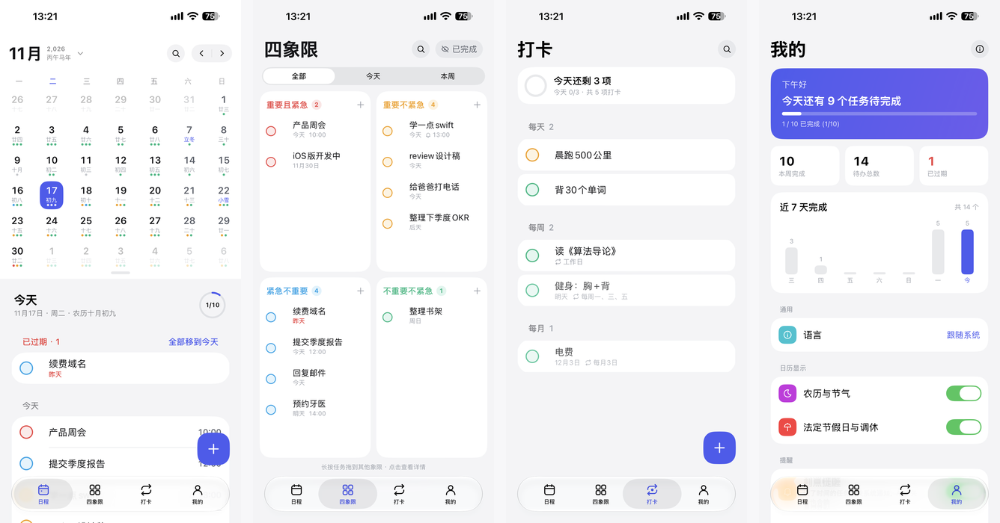
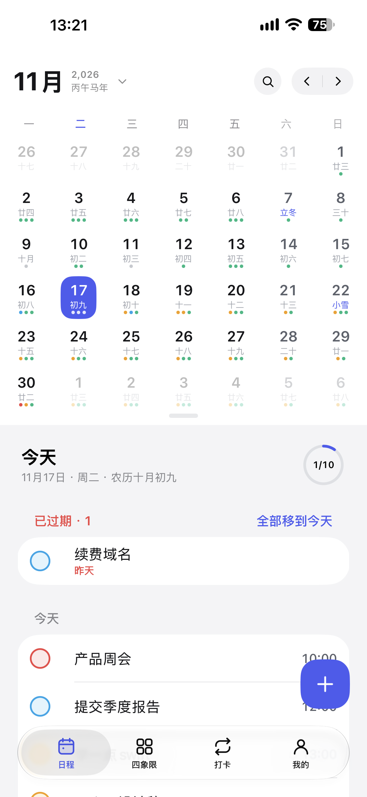
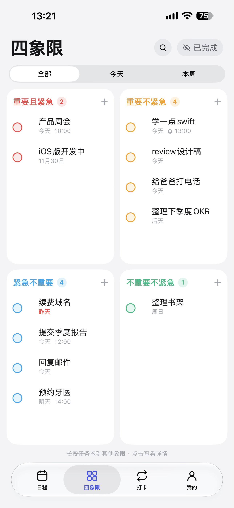
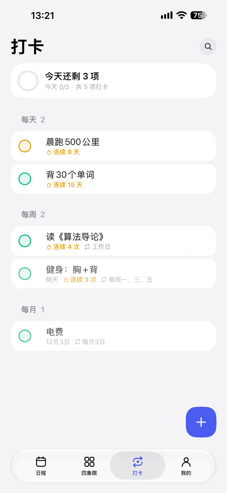
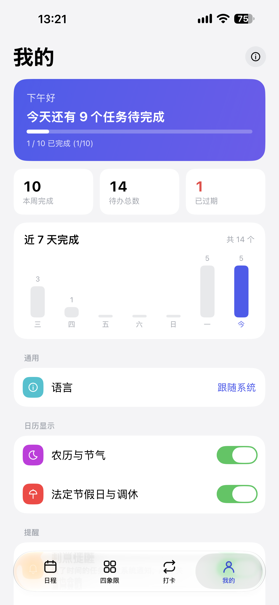

<div align="center">


# 可及清单 · Reach List

**A fast, beautiful daily planner for iPhone, built around a Chinese calendar and the Eisenhower matrix.**
<br>
**And your AI agent can read and manage your tasks, too.**

**English** · [简体中文](README.zh-CN.md)

[](https://github.com/TonyWu2333/reachlist/releases) [](#-build) [](Planner/) [](#-tech-stack) [](#-let-your-ai-agent-manage-your-tasks)

[Features](#-features) · [Screenshots](#-screenshots) · [Build](#-build) · [Agent access](#-let-your-ai-agent-manage-your-tasks) · [Develop](#develop)

<br>



</div>

<br>

## ✨ Why 可及清单

Most to-do apps are either too simple to plan with or too heavy to open every morning. 可及清单 (Reach List, formerly 每日计划) is built for the middle: **open it, see today, tap, done**. It is the first app in 可及 (Reach), a family of small tools that keep your data with you and can be driven by your own AI agents.

- 🗓️ **A calendar that fits how you actually live.** Lunar dates, solar terms, festivals and Chinese 休 / 班 public-holiday schedules are right there on the month view.
- 🧭 **Decide what matters.** Every task can be placed on a 2×2 Eisenhower matrix. Long-press and drag to re-prioritise.
- ⚡ **Type it like you'd say it.** `明天下午3点开会` becomes a task tomorrow at 15:00. `每周五晚上8点 羽毛球` becomes a weekly repeat.
- 🤖 **Agent-ready.** A tiny self-hosted sync server plus an installable skill lets Claude Code, Codex or Hermes read, add and complete your tasks.
- 🔒 **Your data stays yours.** Everything is stored on the phone. Sync is optional, self-hosted, and one JSON file.

## 🚀 Features

| | |
|---|---|
| **Month ⇄ week calendar** | Collapsible, finger-following swipes, colour dots for each quadrant, lunar calendar & official holiday / make-up-workday marks |
| **Eisenhower matrix** | Important × urgent quadrants, range filter (all / today / this week), long-press drag between quadrants |
| **Natural-language quick add** | Chinese date, time and repeat parsing, with a live "recognised as…" preview you can undo |
| **Flexible repeats** | Every N days / weeks / months / years, pick weekdays, optional end date; skip or complete a single occurrence |
| **Routines (打卡)** | All repeating tasks in one tab, grouped by rule, with a progress ring and 🔥 streak counters |
| **Subtasks** | Full tasks of their own: own date, time, reminder, quadrant and notes |
| **Reminders** | Local notifications for the next 30 days, including repeats, with exact alarms |
| **Gestures** | Swipe right to complete; swipe left to postpone, drop or delete; undo toast; haptics |
| **Search** | Across titles and notes, multiple terms must all match |
| **Dropped state** | Mark a task as "no longer planning to do" without deleting its history |
| **Backup & sync** | JSON export / import, plus optional sync to your own server |
| **English and Chinese** | Follows the system language, or pick one under Me → Language. Natural-language quick add understands Chinese |
| **Polished details** | Edge-to-edge UI; bottom sheets move frame by frame with the keyboard |

## 📸 Screenshots

<table>
  <tr>
    <td align="center"><br><sub><b>Calendar</b><br>lunar, holidays, agenda</sub></td>
    <td align="center"><br><sub><b>Eisenhower matrix</b><br>drag between quadrants</sub></td>
    <td align="center"><br><sub><b>Routines</b><br>streaks &amp; progress</sub></td>
    <td align="center"><br><sub><b>Me</b><br>stats &amp; settings</sub></td>
  </tr>
</table>

<sub>Screenshots use demo data.</sub>

## 📲 Build

There is no App Store listing yet. Build it with Xcode (iOS 26+ SDK):

```bash
git clone https://github.com/Mrkinggggg/reachlist-ios.git && cd reachlist-ios
open Planner.xcodeproj
```

Before running on a real device, set your own `DEVELOPMENT_TEAM` in
`Planner/Config/Signing.xcconfig` (the repo ships the placeholder `YOUR_TEAM_ID`).
The minimum deployment target is iOS 26.

## 🤖 Let your AI agent manage your tasks

```
iPhone app  ⇄  sync server (your server or this Mac)  ⇄  `planner` CLI + SKILL.md used by the agent
```

Ask things like *"what do I have today?"*, *"move the dentist to Friday"* or *"plan my week"*, and the agent edits the same tasks you see on your phone. Setup is three steps: run the server, paste the connection code on the phone, copy `skill/planner` into your agent's skills folder. The server and skill live in the [upstream repository](https://github.com/TonyWu2333/reachlist); this app speaks the same protocol. Details in [Agent access](#agent-access-sync-server--skill).

## 🧱 Tech stack

Swift 6 · SwiftUI (iOS 26+) · Foundation only in `Core/` · URLSession long polling · UNUserNotificationCenter · self-hosted Node sync server (from upstream) · a bundled CLI that reuses the app's own parsing and repeat logic.

---

## Develop

Open `Planner.xcodeproj` and run the `Planner` scheme. `Core/` has no UIKit / SwiftUI dependency, so its logic can be verified with a standalone `swiftc` harness; `PlannerTests/` runs the same assertions on a real device with golden fixtures generated from the upstream JS source.

## Layout

| Path | Purpose |
|---|---|
| `Planner/Core/Models/` | Task model and legacy migration; one canonical JSON fragment source for persistence and signatures. |
| `Planner/Core/Calendar/` | Date helpers, lunar calendar, solar terms, festivals and 休 / 班 marks from a bundled static table. |
| `Planner/Core/Parse/` | Chinese natural-language date / time / repeat parsing for quick add (`明天下午3点开会`). |
| `Planner/Core/Repeat/` | Repeating tasks: rule parsing, expansion per day, per-day `doneDates` / `skipDates`. |
| `Planner/Core/Sync/` | Merge engine (per task, newer `updatedAt` wins), task store, sync client and connection-code settings. |
| `Planner/Core/Notify/` | Local reminders: plans the next 30 days of notifications and re-schedules on change. |
| `Planner/Core/Backup/` | JSON export / import with the upstream file format. |
| `Planner/Features/` | Calendar, Eisenhower matrix, routines, Me, task detail and quick add. |
| `Planner/App/` | Entry point, tab skeleton, design system and feedback layer. |
| `PlannerTests/` | XCTest plus golden fixtures; the `generate_*.mjs` generators need the upstream `src/lib/` to re-run, the committed JSON fixtures can be asserted independently. |

## Agent access (sync server + skill)

Agents such as Claude Code, Codex or Hermes can read and change the same tasks through a small self-hosted sync server:

```
iPhone app  ⇄  sync server (your server or this Mac)  ⇄  `planner` CLI + SKILL.md used by the agent
```

| Path | Purpose (in the [upstream repository](https://github.com/TonyWu2333/reachlist)) |
|---|---|
| `shared/merge.js` | Merge rule shared by app, server and CLI: per task, newer `updatedAt` wins; tombstones in `deleted` win over older edits. |
| `server/server.js` | Sync server: one JSON file behind a bearer token, `GET /api/state`, `POST /api/sync`, `GET /api/wait` (long poll). Node 18+, no dependencies. |
| `agent/cli.js` | `planner` CLI (today / list / search / add / done / skip / drop / edit / delete). |
| `skill/planner/` | The installable skill: `SKILL.md`, bundled `scripts/planner.mjs` and `server/planner-server.mjs`. |

**Run the server** (on a machine both the phone and the agent can reach):

```bash
PLANNER_TOKEN=$(openssl rand -hex 24) PORT=18787 DATA_FILE=/var/lib/planner/data.json \
  node skill/planner/server/planner-server.mjs
```

It prints a connection code `http://host:18787#token`. On a public server, put it behind HTTPS and use `https://planner.example.com#token`.

**Connect the phone:** Me → Sync & Agent → turn on, paste the connection code.

**Give an agent the skill:** copy or symlink `skill/planner` into the agent's skills folder, then run `node <skill>/scripts/planner.mjs login '<code>'` once on that machine, or set `PLANNER_CODE`.

## Data

Task shape: `{ id, title, note, date: 'YYYY-MM-DD' | '', time: 'HH:MM' | '', important, urgent, done, dropped, createdAt, doneAt, updatedAt, repeat, doneDates, skipDates, remind, parentId }` (`remind`: minutes before, `null` = off; `repeat`: rule string).
Data lives in the app's private storage and is wiped on uninstall — export a backup regularly, or turn on sync.

## Credits

This is the iOS native implementation of [可及清单 · Reach List](https://github.com/TonyWu2333/reachlist). The `Core/` algorithms are contract-equivalent to the upstream `src/lib/*.js` and `shared/merge.js` at baseline `97a7c4c`, verified by golden fixtures asserted on a real device.
