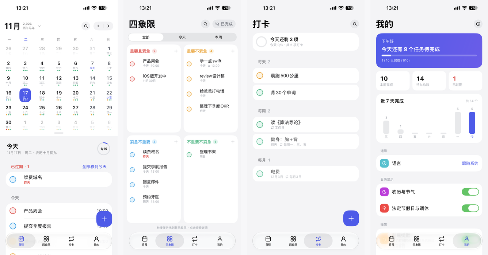
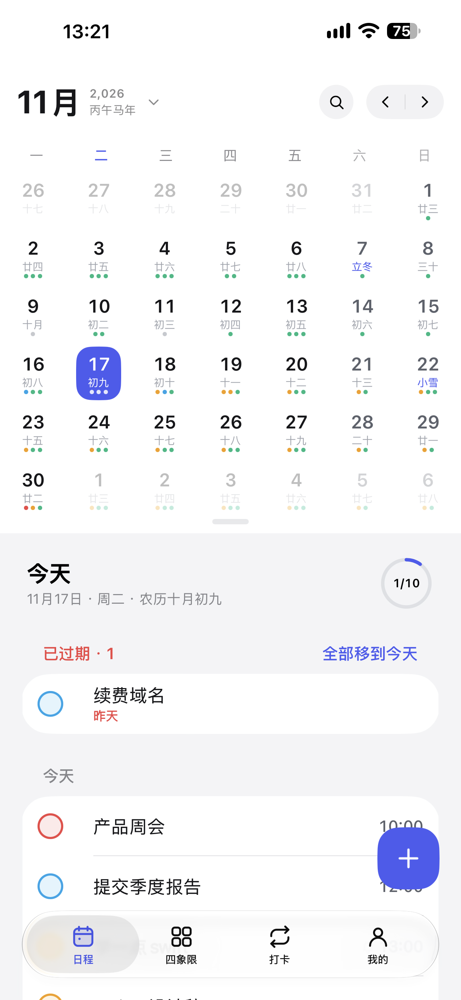
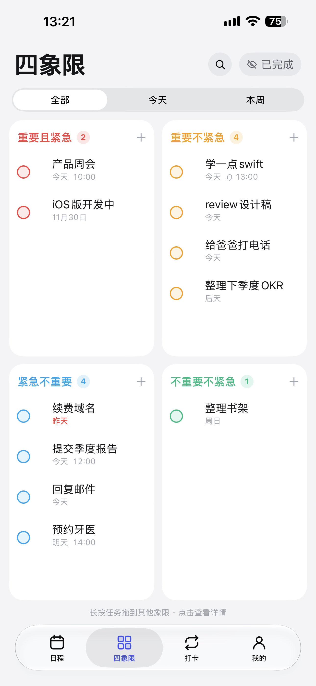
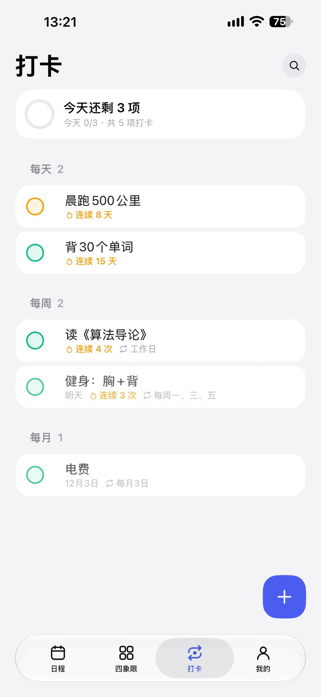
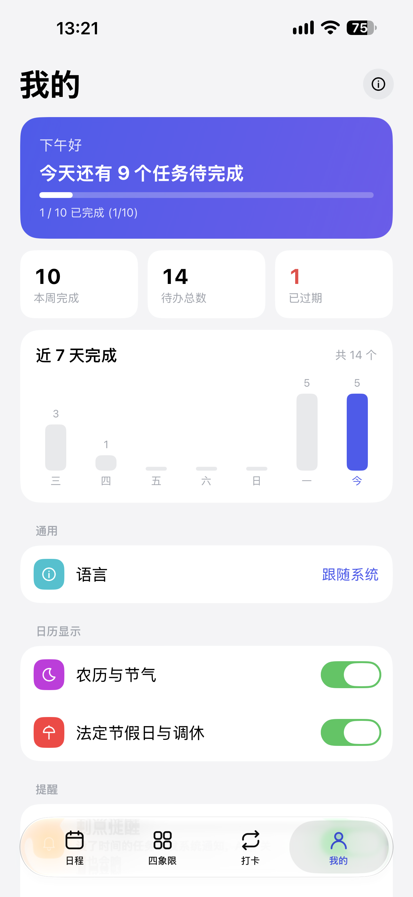

<div align="center">


# 可及清单

**轻快、好看的 iPhone 日程应用：农历日历 + 四象限 + 打卡。**
<br>
**你的 AI agent 也能直接看和改你的任务。**

[English](README.md) · **简体中文**

[](https://github.com/TonyWu2333/reachlist/releases) [](#-构建) [](Planner/) [](#-技术栈) [](#-让-ai-agent-帮你管任务)

[功能](#-功能) · [截图](#-截图) · [构建](#-构建) · [Agent 接入](#-让-ai-agent-帮你管任务) · [开发](#开发)

<br>



</div>

<br>

## ✨ 为什么做可及清单

大多数待办 App 要么太简单，做不了计划；要么太重，每天早上都懒得打开。可及清单想做中间那一档：**打开、看今天、点一下、完事**。

它是「可及」系列工具的第一款（原名「每日计划」）。这个系列的每个工具都能独立使用，数据留在你自己手里，也都能让你的 AI agent 通过 skill 来操作。

- 🗓️ **贴合国内生活的日历。** 月视图上直接显示农历、节气、节日，以及法定节假日的「休」和调休的「班」。
- 🧭 **分清轻重缓急。** 每个任务都能放进「重要 × 紧急」四象限，长按拖动就能调整优先级。
- ⚡ **怎么说就怎么记。** 输入 `明天下午3点开会`，就是明天 15:00 的任务；`每周五晚上8点 羽毛球` 就是每周重复。
- 🤖 **Agent 可用。** 一个很小的自建同步服务器加一个可安装的 skill，Claude Code、Codex、Hermes 就能读取、添加和完成你的任务。
- 🔒 **数据是你的。** 全部存在手机里；同步是可选的，服务器自己搭，数据就是一个 JSON 文件。

## 🚀 功能

| | |
|---|---|
| **月 ⇄ 周日历** | 可折叠，跟手滑动；每天用彩色小点标出各象限的任务；农历、法定节假日和调休标记 |
| **四象限** | 重要 × 紧急四个象限，可按全部 / 今天 / 本周筛选，长按拖到其他象限 |
| **一句话添加** | 识别中文日期、时间和重复规则，实时显示「识别为……」，不对可以一键撤销 |
| **灵活的重复** | 每 N 天 / 周 / 月 / 年，可选星期几，可设结束日期；单次可以跳过或单独完成 |
| **打卡** | 所有重复任务集中在一个页面，按规则分组，带进度环和 🔥 连续天数 |
| **子任务** | 子任务也是完整的任务：有自己的日期、时间、提醒、象限和备注 |
| **提醒** | 本地通知，提前排好未来 30 天（含重复任务），使用精确闹钟 |
| **手势** | 右滑完成；左滑推迟、放弃或删除；可撤销的提示；触感反馈 |
| **搜索** | 搜索标题和备注，多个关键词需同时命中 |
| **放弃** | 把任务标记为「不打算做了」，不删除，保留记录 |
| **备份与同步** | 导出 / 导入 JSON，也可以同步到你自己的服务器 |
| **中英文界面** | 跟随系统语言，也可以在「我的 → 语言」里切换；一句话添加目前只识别中文 |
| **细节打磨** | 全面屏沉浸式界面；底部弹窗和键盘动画逐帧同步 |

## 📸 截图

<table>
  <tr>
    <td align="center"><br><sub><b>日程</b><br>农历、节假日、当日安排</sub></td>
    <td align="center"><br><sub><b>四象限</b><br>在象限之间拖动</sub></td>
    <td align="center"><br><sub><b>打卡</b><br>连续天数与进度</sub></td>
    <td align="center"><br><sub><b>我的</b><br>统计与设置</sub></td>
  </tr>
</table>

<sub>截图使用的是演示数据。</sub>

## 📲 构建

暂时没有上架 App Store，用 Xcode 自己构建（需要 iOS 26+ SDK）：

```bash
git clone https://github.com/Mrkinggggg/reachlist-ios.git && cd reachlist-ios
open Planner.xcodeproj
```

真机运行前，把 `Planner/Config/Signing.xcconfig` 里的 `DEVELOPMENT_TEAM` 改成你自己的 Team ID（仓库里是占位值 `YOUR_TEAM_ID`）。最低部署目标 iOS 26。

## 🤖 让 AI agent 帮你管任务

```
iPhone App  ⇄  同步服务器（你的服务器或这台电脑）  ⇄  agent 使用的 planner 命令行 + SKILL.md
```

你可以问 agent「我今天有什么事」「把看牙医挪到周五」「帮我排一下这周」，它改的就是你手机上看到的那些任务。配置只要三步：运行服务器，在手机上粘贴连接码，把 `skill/planner` 放进 agent 的 skills 文件夹。服务器和 skill 在[上游仓库](https://github.com/TonyWu2333/reachlist)中，本 App 使用同一套协议。详见 [Agent 接入（同步服务器 + skill）](#agent-接入同步服务器--skill)。

## 🧱 技术栈

Swift 6 · SwiftUI（iOS 26+）· `Core/` 只依赖 Foundation · URLSession 长轮询 · UNUserNotificationCenter · 上游的无依赖 Node 同步服务器 · 打包好的命令行工具（复用 App 自己的解析和重复规则逻辑）。

---

## 开发

打开 `Planner.xcodeproj`，运行 `Planner` scheme。`Core/` 不依赖 UIKit / SwiftUI，逻辑可用独立的 `swiftc` harness 验证；`PlannerTests/` 在真机上用由上游 JS 源码生成的黄金夹具做全量断言。

## 代码结构

| 路径 | 作用 |
|---|---|
| `Planner/Core/Models/` | 任务模型与旧数据迁移；持久化与任务签名共用唯一的 JSON 片段来源。 |
| `Planner/Core/Calendar/` | 日期工具；农历、节气、节日和「休 / 班」来自随包内置的静态表。 |
| `Planner/Core/Parse/` | 快速添加用的中文自然语言解析：日期、时间、重复规则（`明天下午3点开会`）。 |
| `Planner/Core/Repeat/` | 重复任务：规则解析、按天展开、每天的完成与跳过记在 `doneDates` / `skipDates`。 |
| `Planner/Core/Sync/` | 合并引擎（按任务比较，`updatedAt` 新者胜出）、任务存储、同步客户端、连接码设置。 |
| `Planner/Core/Notify/` | 本地提醒：排好未来 30 天的通知，每次改动后重新排程。 |
| `Planner/Core/Backup/` | 按上游文件格式导出 / 导入 JSON。 |
| `Planner/Features/` | 日历、四象限、打卡、我的、任务详情与快速添加。 |
| `Planner/App/` | 入口、四个 tab 的骨架、设计系统与反馈层。 |
| `PlannerTests/` | XCTest 与黄金夹具；`generate_*.mjs` 生成器需要上游 `src/lib/` 才能重跑，已提交的 JSON 夹具可独立断言。 |

## Agent 接入（同步服务器 + skill）

Claude Code、Codex、Hermes 等 agent 可以通过一个自建的小型同步服务器，读写和你手机上同一份任务：

```
iPhone App  ⇄  同步服务器（你的服务器或这台电脑）  ⇄  agent 使用的 planner 命令行 + SKILL.md
```

| 路径（在[上游仓库](https://github.com/TonyWu2333/reachlist)中） | 作用 |
|---|---|
| `shared/merge.js` | App、服务器和命令行共用的合并规则：按任务比较，`updatedAt` 新的那份胜出；`deleted` 里的删除记录会覆盖比它更早的修改。 |
| `server/server.js` | 同步服务器：一个 JSON 文件，用 Bearer 令牌保护；`GET /api/state`、`POST /api/sync`、`GET /api/wait`（长轮询）。Node 18+，无依赖。 |
| `agent/cli.js` | `planner` 命令行（today / list / search / add / done / skip / drop / edit / delete）。 |
| `skill/planner/` | 可安装的 skill：`SKILL.md`，以及打包好的 `scripts/planner.mjs` 和 `server/planner-server.mjs`。 |

**运行服务器**（放在手机和 agent 都能访问到的机器上）：

```bash
PLANNER_TOKEN=$(openssl rand -hex 24) PORT=18787 DATA_FILE=/var/lib/planner/data.json \
  node skill/planner/server/planner-server.mjs
```

启动后会打印连接码 `http://主机:18787#令牌`。如果放在公网服务器上，请在前面加 HTTPS，连接码改用 `https://planner.example.com#令牌`。

**连接手机：** 我的 → 同步与 Agent → 打开开关，粘贴连接码。

**给 agent 装 skill：** 把 `skill/planner` 复制或软链接到 agent 的 skills 文件夹，然后在那台机器上运行一次 `node <skill目录>/scripts/planner.mjs login '<连接码>'`，或者设置环境变量 `PLANNER_CODE`。

## 数据

任务结构：`{ id, title, note, date: 'YYYY-MM-DD' | '', time: 'HH:MM' | '', important, urgent, done, dropped, createdAt, doneAt, updatedAt, repeat, doneDates, skipDates, remind, parentId }`（`remind`：提前多少分钟提醒，`null` 表示关闭；`repeat`：重复规则字符串）。

数据存在应用私有目录里，卸载 App 会一起删除。请定期导出备份，或者打开同步。

## 关于

本仓库是 [可及清单 · Reach List](https://github.com/TonyWu2333/reachlist) 的 iOS 原生实现。`Core/` 下的算法与上游 `src/lib/*.js`、`shared/merge.js` 在基线 `97a7c4c` 上逐字等价，由真机上的黄金夹具断言保证。
